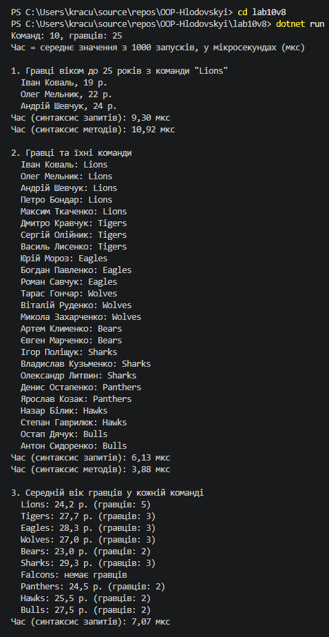

# Звіт з лабораторної роботи №10

- **Тема:** LINQ в дії: фільтри, join, агрегації. Продуктивність.
- **Мета:** Навчитися ефективно використовувати LINQ для фільтрації, об'єднання (join) та агрегації даних, а також аналізувати продуктивність LINQ-запитів.
- **Варіант:** №8 (спортивна ліга)

---

## Хід роботи

У межах роботи створено консольний проєкт lab10v8.

- **Team** — клас команди з властивостями `Id`, `Name`, `City`.
- **Player** — клас гравця з властивостями `Id`, `Name`, `TeamId`, `Age`. Поле `TeamId` пов'язує гравця з командою.

Тестові дані: 10 команд і 25 гравців. У команді Falcons навмисно немає гравців, а двоє гравців мають однаковий максимальний вік (36 років).

Кожен запит написано у двох варіантах: синтаксисом запитів (`from ... select`) і синтаксисом методів.

1. Гравці віком до 25 років з команди "Lions": `join` + `where`.
2. Гравці разом з назвою команди: `join` / `Join`.
3. Середній вік гравців у кожній команді: `join ... into` / `GroupJoin` + `Average`. Завдяки GroupJoin у результаті є і команда без гравців.
4. Найстарші гравці: `Max` для пошуку максимального віку, потім `where` / `Where` для всіх гравців з таким віком.

Час кожного запиту виміряно через `Stopwatch`. Спершу запит виконується один раз для прогріву (JIT-компіляція), потім 1000 разів, і виводиться середній час у мікросекундах. Усередині вимірювання викликається `ToList()`, бо без нього через відкладене виконання запит не виконався б.

## Результат виконання

---

## Висновок:
Найшвидшим виявився пошук найстаршого гравця (`Max` + `Where`, близько 1 мкс), бо це прості проходи по одному списку. Запити з `Join` виконуються приблизно в 4 рази повільніше, бо `Join` спершу будує таблицю пошуку за ключем і створює новий об'єкт для кожної пари. Найдорожчим став `GroupJoin` з `Average` (близько 6 мкс), бо для кожної команди додатково збирається група гравців і рахується середнє. Синтаксис запитів і синтаксис методів дають майже однаковий час, бо компілятор перетворює запит на виклики тих самих методів.
