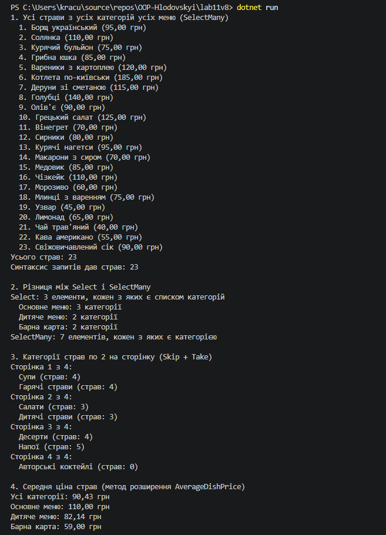
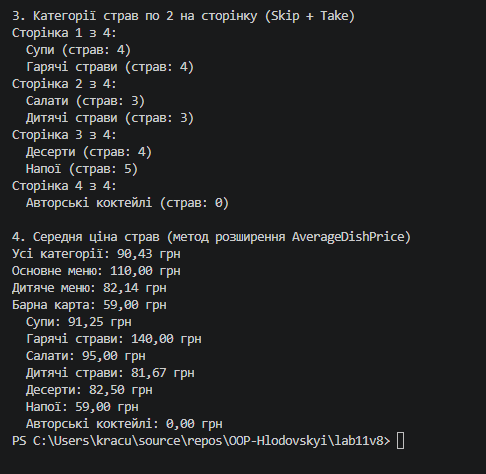

# Звіт з лабораторної роботи №11

- **Тема:** LINQ: SelectMany, пагінація й custom extensions.
- **Мета:** Навчитися використовувати оператор SelectMany для роботи з вкладеними колекціями, реалізовувати пагінацію даних за допомогою LINQ, а також створювати власні методи розширення для IEnumerable<T> або ключових доменних сутностей.
- **Варіант:** №8 (меню ресторану та категорії страв)

---

## Хід роботи

У межах роботи створено консольний проєкт lab11v8.

- **Dish** — страва з властивостями `Id`, `Name`, `Price`.
- **DishCategory** — категорія з властивостями `Id`, `Name` і вкладеною колекцією `List<Dish> Dishes`.
- **RestaurantMenu** — меню з властивостями `Id`, `Name` і вкладеною колекцією `List<DishCategory> Categories`.
- **DishCategoryExtensions** — статичний клас з методом розширення `AverageDishPrice()` для `IEnumerable<DishCategory>`. Метод збирає страви з усіх переданих категорій через `SelectMany` і повертає їхню середню ціну, а якщо страв немає, повертає 0.

Тестові дані: 3 меню, 7 категорій і 23 страви. Категорія "Авторські коктейлі" навмисно порожня.

У `Main()` продемонстровано:

1. SelectMany: усі страви з усіх категорій усіх меню одним списком, синтаксисом методів і синтаксисом запитів (кілька `from` підряд).
2. Різницю між `Select` (повертає 3 списки категорій) і `SelectMany` (повертає 7 категорій одним списком).
3. Пагінацію: усі категорії по 2 на сторінку через `Skip((page - 1) * pageSize).Take(pageSize)`, усього 4 сторінки, остання неповна.
4. Метод розширення `AverageDishPrice()` для всіх категорій, для кожного меню і для кожної категорії окремо.

## Результат виконання

---

## Контрольні питання

**1. Для чого використовується оператор SelectMany? Наведіть приклад, що демонструє його відмінність від Select.**
SelectMany використовують, коли кожен елемент містить колекцію і всі ці колекції треба об'єднати в один плоский список. `menus.Select(m => m.Categories)` повертає 3 окремі списки категорій, а `menus.SelectMany(m => m.Categories)` повертає один список із 7 категорій.

**2. Як реалізувати пагінацію даних за допомогою LINQ? Які методи для цього використовуються?**
Для пагінації використовують `Skip` і `Take`: `Skip((page - 1) * pageSize)` пропускає елементи попередніх сторінок, а `Take(pageSize)` бере елементи поточної. Кількість сторінок рахується як `Math.Ceiling(кількість / pageSize)`.

**3. Поясніть концепцію методів розширення. Як вони інтегруються з LINQ?**
Метод розширення дозволяє додати новий метод до наявного типу, не змінюючи його код. Його оголошують статичним методом у статичному класі, а перед першим параметром пишуть `this`. Самі методи LINQ (`Where`, `Select`, `SelectMany`) теж є методами розширення для `IEnumerable<T>`, тому власні методи можна викликати в тому ж ланцюжку.

**4. Наведіть приклад власного методу розширення для IEnumerable<T> та поясніть його призначення.**
У цій роботі це `AverageDishPrice(this IEnumerable<DishCategory> categories)`. Він рахує середню ціну страв у переданих категоріях, тож замість окремого `SelectMany` і `Average` достатньо написати `menu.Categories.AverageDishPrice()`.

---

## Висновок:
SelectMany зручно "розгортає" вкладені колекції (меню, категорії, страви) в один список, з яким далі легко працювати. Пагінація через Skip і Take дозволяє виводити великі набори даних частинами. Власний метод розширення AverageDishPrice() ховає бізнес-логіку в одному місці й викликається так само просто, як і стандартні методи LINQ.
