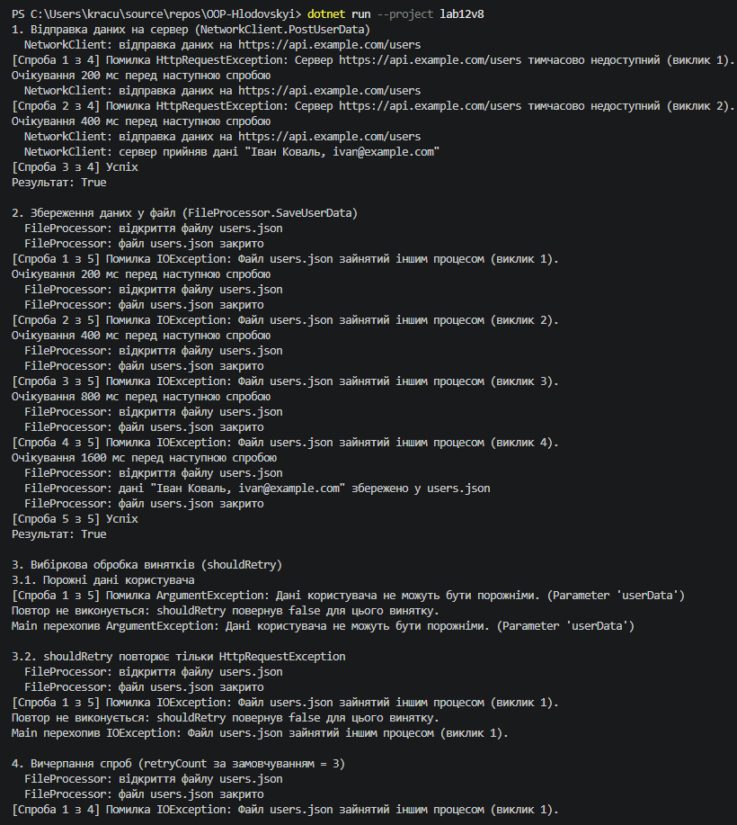
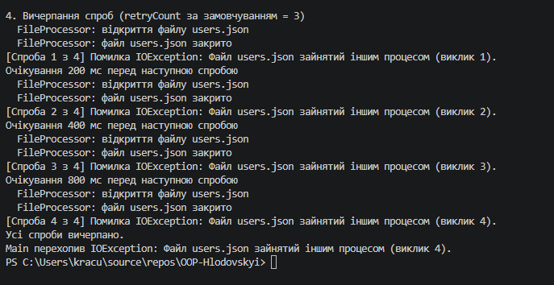

# Звіт з лабораторної роботи №12

- **Тема:** Обробка IO/мережевих помилок та патерн Retry.
- **Мета:** Навчитися обробляти типові помилки вводу/виводу та мережеві помилки за допомогою блоків try-catch-finally, а також реалізувати патерн Retry для підвищення відмовостійкості застосунків.
- **Варіант:** №8 (збереження даних користувача)

---

## Хід роботи

У межах роботи створено консольний проєкт lab12v8.

- **FileProcessor** — імітує роботу з файлом. Метод `SaveUserData(path, userData)` перші 4 рази кидає `IOException`, а на 5-й раз "зберігає" дані. Блок `finally` закриває файл після кожної спроби. Для порожніх даних метод кидає `ArgumentException`.
- **NetworkClient** — імітує мережевий запит. Метод `PostUserData(url, userData)` перші 2 рази кидає `HttpRequestException`, а на 3-й раз повертає `true`.
- **RetryHelper** — статичний клас з узагальненим методом `ExecuteWithRetry<T>(Func<T> operation, int retryCount, TimeSpan initialDelay, Func<Exception, bool>? shouldRetry)`. Він виконує операцію, логує кожну спробу та причину невдачі і повторює її з експоненційною затримкою `initialDelay * 2^(номер повтору - 1)`. Якщо `shouldRetry` повертає `false` або спроби закінчились, виняток передається далі.

У `Main()` продемонстровано:

1. `PostUserData`: 2 невдачі, потім успіх.
2. `SaveUserData`: 4 невдачі, потім успіх (`retryCount: 4`). Метод нічого не повертає, тому його виклик обгорнуто в лямбду, що повертає `true`.
3. Вибіркову обробку через `shouldRetry`: `ArgumentException` від порожніх даних не повторюється, а `shouldRetry`, що дозволяє тільки `HttpRequestException`, не повторює `IOException`.
4. Вичерпання спроб: з `retryCount` за замовчуванням (3) операція з 4 невдачами не встигає вдатися, і виняток перехоплюється в `Main()`.

## Результат виконання

---

## Висновок:
Експоненційна затримка подвоює паузу після кожної невдалої спроби: для `SaveUserData` це 200, 400, 800 і 1600 мс перед п'ятою, успішною спробою. Так перші повтори відбуваються швидко, а якщо збій затягується, програма чекає все довше і не перевантажує файл чи сервер частими запитами. Разом із `shouldRetry` це дозволяє повторювати лише ті помилки, які справді можуть зникнути самі.
