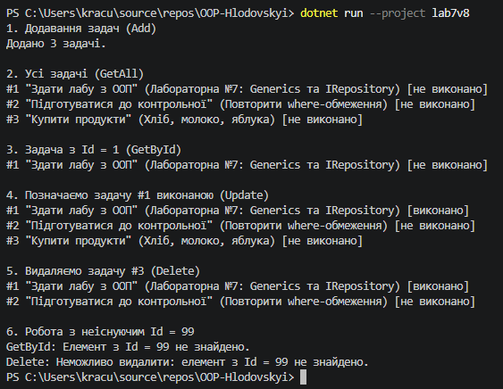
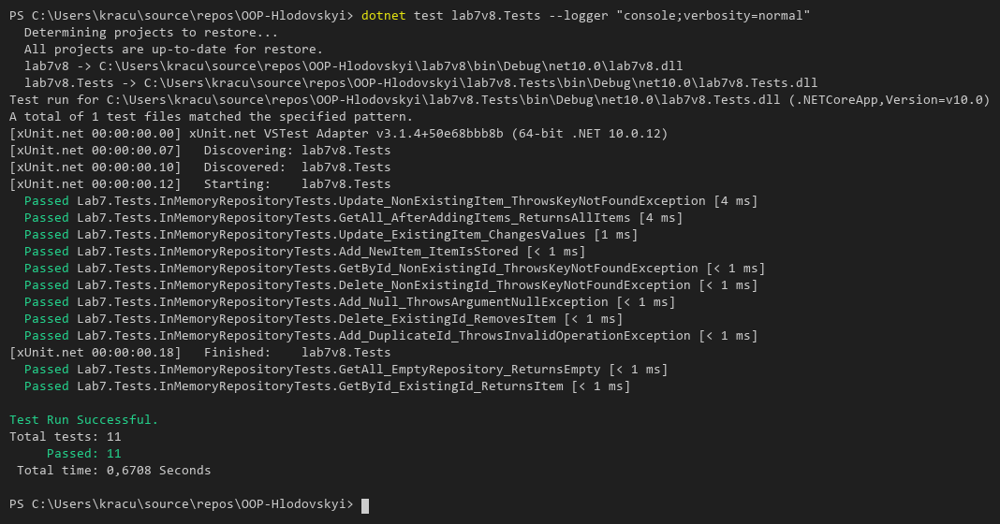

# Звіт з лабораторної роботи №7

* **Тема:** Узагальнені типи (Generics). IRepository з where-обмеженнями та тестами.
* **Мета:** Навчитися створювати узагальнені інтерфейси та класи, застосовувати where-обмеження для типів-параметрів, а також розробляти юніт-тести для перевірки коректності узагальнених реалізацій.
* **Варіант:** №8
---
## Хід роботи
У межах роботи створено два проєкти: консольний lab7v8 і тестовий lab7v8.Tests (xUnit) з посиланням на lab7v8.

* **IEntity** — інтерфейс із властивістю `int Id { get; set; }`.
* **IRepository<T>** — узагальнений інтерфейс з методами `GetById`, `GetAll`, `Add`, `Update`, `Delete` та обмеженням `where T : IEntity`, завдяки якому в коді репозиторію доступна властивість `Id`.
* **InMemoryRepository<T>** — реалізація `IRepository<T>`, яка зберігає елементи у `List<T>`. Для неіснуючого `Id` кидає `KeyNotFoundException`, для дубліката `Id` — `InvalidOperationException`.
* **TaskItem** — сутність за варіантом з властивостями `Title`, `Description`, `IsCompleted` та `Id`.

У `Main()` продемонстровано додавання, отримання, оновлення та видалення задач, а також роботу з неіснуючим `Id`. У проєкті lab7v8.Tests написано 11 юніт-тестів для всіх CRUD-методів, включно з неіснуючими елементами.

## Результат виконання

---

## Висновок:
Generics дозволяють написати один репозиторій для будь-якої сутності без дублювання коду та приведення типів. Обмеження where T : IEntity гарантує, що кожен тип має Id, тому пошук за ідентифікатором працює для всіх сутностей. Юніт-тести підтверджують правильність усіх CRUD-операцій, зокрема для неіснуючих елементів.
