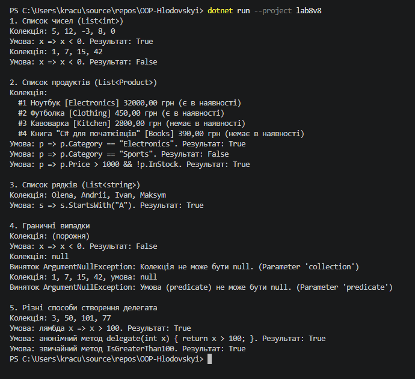

# Звіт з лабораторної роботи №8

* **Тема:** Делегати й лямбда-вирази у практиці колекцій: CollectionHelper<T>.
* **Мета:** Навчитися передавати поведінку як параметр через делегати Func, Action, Predicate, будувати на цій основі універсальні операції над колекціями та використовувати лямбда-вирази у практиці ООП.
* **Варіант:** №8 (метод Any)
---
## Хід роботи
У межах роботи створено консольний проєкт lab8v8.

* **CollectionHelper<T>** — статичний узагальнений клас з методом `Any(IEnumerable<T> collection, Predicate<T> predicate)`, який повертає `true`, якщо хоча б один елемент задовольняє умову. Умова передається через делегат `Predicate<T>`. LINQ не використано: метод перебирає колекцію циклом `foreach` і повертає `true` на першому збігу, для порожньої колекції повертає `false`, а для `null` кидає `ArgumentNullException`.
* **Product** — клас з властивостями `Id`, `Name`, `Category`, `Price`, `InStock` і перевизначеним `ToString()`.

У `Main()` метод `Any` викликано з лямбда-виразами для `List<int>`, `List<Product>` і `List<string>`, перевірено граничні випадки (порожня колекція та `null`), а також показано, що делегат можна створити лямбда-виразом, анонімним методом або звичайним методом.

## Результат виконання

---

## Висновок:
Делегати дозволяють передавати поведінку в метод як параметр, тому один метод `Any` працює з будь-якими колекціями та умовами. Predicate<T> — готовий узагальнений делегат для перевірки умови, що повертає bool. Лямбда-вирази дають змогу записати таку умову коротко прямо в місці виклику.
