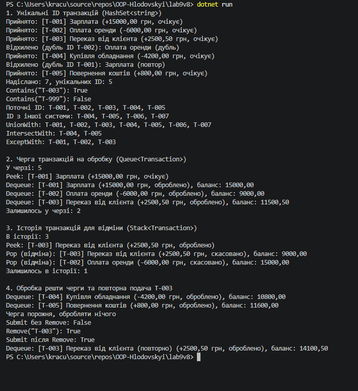

# Звіт з лабораторної роботи №9

- **Тема:** HashSet/Queue/Stack: практичні сценарії.
- **Мета:** Навчитися використовувати спеціалізовані колекції `HashSet<T>`, `Queue<T>`, `Stack<T>` для розв'язання практичних задач, зрозуміти їхні особливості та сценарії застосування.
- **Варіант:** №8 (обробка транзакцій)

---

## Хід роботи

У межах роботи створено консольний проєкт lab9v8.

- **Transaction** — клас з властивостями `Id`, `Description`, `Amount`, `Status` і перевизначеним `ToString()`.
- **TransactionProcessor** — клас, що містить три колекції та методи роботи з ними:
  - `HashSet<string>` — унікальні ID транзакцій. Метод `Submit` додає ID через `Add`, і якщо такий ID вже є, транзакція відхиляється. Також використано `Contains`, `Remove`, `UnionWith`, `IntersectWith`, `ExceptWith`.
  - `Queue<Transaction>` — черга транзакцій на обробку. `Enqueue` при додаванні, `Peek` для перегляду наступної, `Dequeue` для обробки у порядку надходження (FIFO).
  - `Stack<Transaction>` — історія оброблених транзакцій для відміни. `Push` після обробки, `Peek` для перегляду останньої, `Pop` для відміни починаючи з останньої (LIFO).

У `Main()` продемонстровано роботу кожної колекції, а також повторну подачу скасованої транзакції (`Remove` з `HashSet`, потім знову `Submit`).

## Результат виконання

